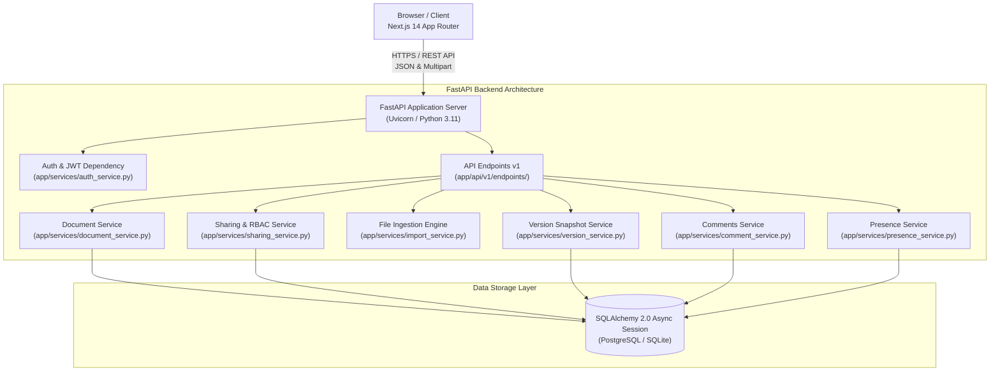
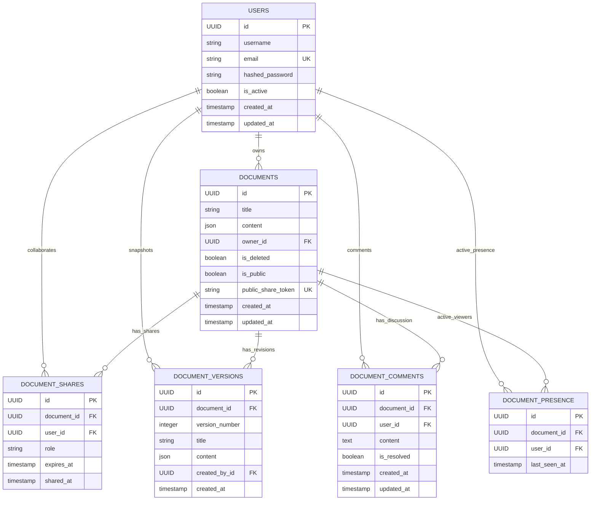
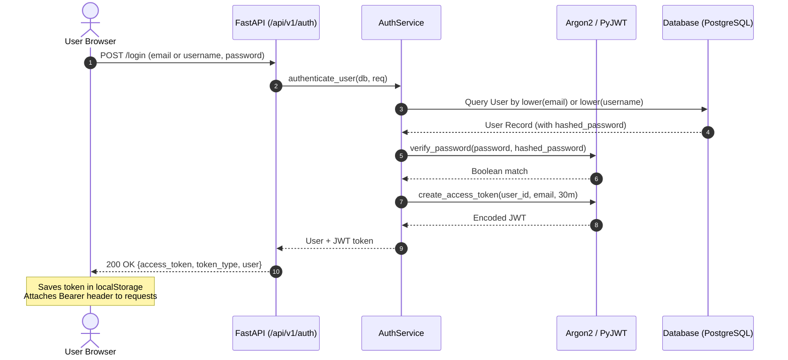

# Draftly — Technical Architecture & Engineering Decisions

This document provides a comprehensive technical overview of Draftly's architecture, data models, security boundaries, and engineering decisions. All components, file paths, endpoints, and database models described herein exist directly within the repository.

---

## 1. High-Level System Architecture

Draftly is built as a decoupled, multi-tier web application designed for high responsiveness, resilient persistence, and secure multi-tenant isolation.



---

## 2. Frontend Architecture & Component Tree

The frontend is built on **Next.js 14** using the App Router. Pages are organized by feature responsibility, with client state managed via dedicated React contexts and hooks.

```
frontend/src/
├── app/
│   ├── layout.tsx                # Root layout with AuthProvider & global styles
│   ├── page.tsx                  # Public landing, hero buttons & system status
│   ├── login/page.tsx            # Login with email/username & password toggle
│   ├── register/page.tsx         # User registration with instant auto-login
│   ├── dashboard/page.tsx        # Workspace atelier: My Documents & Shared With Me
│   ├── documents/[id]/page.tsx   # Role-aware document editor with drawers
│   └── public/[token]/page.tsx   # Public read-only document view
├── components/
│   ├── Navbar.tsx                # Top navigation header & user identity display
│   ├── StatusIndicator.tsx       # Live backend & DB telemetry component
│   ├── dashboard/
│   │   └── ImportModal.tsx       # Drag-and-drop .docx, .md, .txt upload modal
│   └── editor/
│       ├── DraftlyEditor.tsx     # Tiptap headless editor canvas with 1200ms autosave
│       ├── EditorToolbar.tsx     # Formatting bar: H1, H2, Bold, Lists, Alignment
│       ├── ExportMenu.tsx        # Export dropdown: PDF, Markdown (.md), Plain Text (.txt)
│       ├── ShareModal.tsx        # Collaborator invite, role select, expiration & public link
│       ├── VersionHistoryDrawer.tsx # Snapshot drawer with 1-click restore
│       ├── CommentsDrawer.tsx    # Threaded discussion with resolve/delete actions
│       └── PresenceIndicators.tsx # Live active collaborator avatars with pulsing badge
├── context/
│   └── AuthContext.tsx           # Global auth context, localStorage JWT manager
└── lib/
    └── config.ts                 # Type-safe API client helpers & URL normalization
```

### Key Technical Decisions: Frontend
1. **URL Sanitization (`cleanApiBaseUrl` in `config.ts`):** Strips enclosing quotes, trailing slashes, and accidental duplicate `/api` prefixes pasted into Vercel or local environment variables.
2. **Debounced Autosave (`DraftlyEditor.tsx`):** A 1200ms timer buffers user keystrokes before triggering background persistence via `PATCH /api/v1/documents/{id}`. If the user presses `Ctrl+S` or `Cmd+S`, the timer clears and an immediate persistence call fires.
3. **Unsaved Changes Guard (`beforeunload`):** Intercepts browser tab closure or refresh if an autosave request is currently in flight or uncommitted.

---

## 3. Backend Architecture & Service Layer

The backend follows a layered architecture adhering to FastAPI best practices:

- **`app/api/v1/endpoints/`**: Thin request controllers responsible for input validation (via Pydantic schemas) and mapping service responses to HTTP status codes.
- **`app/services/`**: Pure business logic modules containing access control checks, database transactions, hashing, and token signing.
- **`app/models/`**: SQLAlchemy 2.0 declarative models using modern `Mapped[...]` and `mapped_column(...)` constructs.
- **`app/schemas/`**: Pydantic models for strict serialization, type coercion, and auto-generated OpenAPI documentation.
- **`app/core/`**: Centralized configuration (`config.py`), database engine lifecycle (`database.py`), and Argon2/JWT cryptography (`security.py`).

---

## 4. Database Architecture & Entity Relationships

Draftly utilizes a relational database schema designed for strict relational integrity, cascading deletions, and fast indexing.



### Table Specifications:
- **`users`**: Stores user identities. `email` is enforced unique and indexed. `hashed_password` stores Argon2id hashes.
- **`documents`**: Document storage. `content` is stored as structured ProseMirror/Tiptap JSON (`JSONB` in PostgreSQL, `JSON` in SQLite). `is_deleted` implements soft deletion. `public_share_token` holds unique 32-character tokens for public sharing.
- **`document_shares`**: RBAC join table. Enforces a `UniqueConstraint("document_id", "user_id")`. Includes `expires_at` for time-limited collaborator links.
- **`document_versions`**: Revision snapshots storing full content state, sequential `version_number`, and author.
- **`document_comments`**: Threaded discussion entries with `is_resolved` status flag.
- **`document_presence`**: Live collaborator heartbeats updated every 20 seconds.

---

## 5. Authentication & Security Flow

Authentication is stateless and based on industry-standard **Argon2id** password hashing and **HS256 JWT** tokens.



---

## 6. Granular RBAC Permission Matrix

Draftly enforces a 7-action RBAC matrix across the API layer:

| Operation | Owner | Editor | Viewer | Uninvited / Expired |
| :--- | :---: | :---: | :---: | :---: |
| **Read Document Content** | Allowed | Allowed | Allowed | `404 Not Found` |
| **Edit Document Content** | Allowed | Allowed | `403 Forbidden` | `404 Not Found` |
| **Rename Title** | Allowed | `403 Forbidden` | `403 Forbidden` | `404 Not Found` |
| **Soft Delete / Trash** | Allowed | `403 Forbidden` | `403 Forbidden` | `404 Not Found` |
| **Manage Collaborators (Share/Revoke)** | Allowed | `403 Forbidden` | `403 Forbidden` | `404 Not Found` |
| **Create / Restore Versions** | Allowed | Allowed | `403 Forbidden` | `404 Not Found` |
| **Post / View Comments** | Allowed | Allowed | Allowed | `404 Not Found` |

### Security Decision: 404 vs 403 on Multi-Tenant Isolation
When a caller requests a document they do not own and that has not been shared with them, `get_document_with_role()` returns `404 Not Found` rather than `403 Forbidden`. This strictly prevents malicious actors from probing or enumerating valid document UUIDs.

---

## 7. Multi-Format Ingestion Engine

The ingestion pipeline handles three distinct file types up to 10MB via `POST /api/v1/documents/import`:

1. **Microsoft Word (`.docx`):** Handled by `python-docx`. The engine parses body paragraphs, identifies heading hierarchy based on Word XML style names (`Heading 1`, `Heading 2`), extracts bold/italic runs, and transforms them into structured Tiptap nodes.
2. **Markdown (`.md`):** Custom line-by-line AST parser parses ATX headings (`#`, `##`, `###`), blockquotes (`>`), unordered list items (`*`, `-`), ordered lists (`1.`), horizontal rules (`---`), and inline bold/italic marks.
3. **Plain Text (`.txt`):** Decoded with `utf-8` (falling back to `latin-1`), splitting on double line breaks into semantic paragraphs.

---

## 8. Export Implementation

Rather than relying on resource-intensive server-side headless browsers, Draftly implements clean, fast exports:
- **PDF Export:** Uses `window.print()` coupled with dedicated `@media print` CSS rules in `globals.css`. Headers, toolbars, and controls are suppressed, producing a publication-ready PDF document.
- **Markdown Export:** In `ExportMenu.tsx`, an AST serializer recursively traverses the document's active Tiptap JSON node tree, converting headings, marks, lists, blockquotes, and code blocks into clean markdown text downloaded via a `Blob`.
- **Text Export:** Pulls plain text via `editor.getText()` and triggers an immediate download as `[title].txt`.
